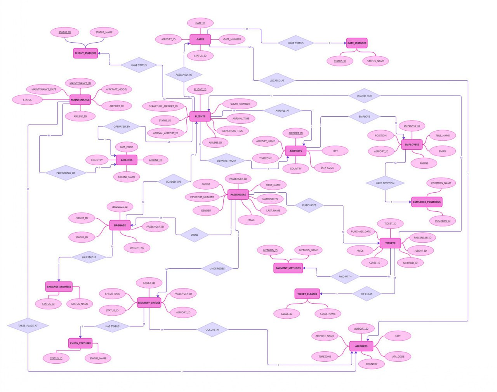

# Airport Management System — Relational Database (Oracle SQL)

A relational database that runs the core operations of an airport: flights, passengers, tickets, gates, baggage, employees, maintenance, and security checks.

**Course:** Database Management Systems, SDU University (April 2025)

**Team:** Rauza Ramazanova, Aidana Terlekbayeva, Merey Abildayeva

## Highlights
- 15+ interrelated tables, normalized up to **BCNF**
- Reference tables for statuses, ticket classes, payment methods, and employee positions
- 100+ realistic rows per table (generated with Mockaroo and adjusted by hand)
- 30+ SQL queries: joins, aggregates, subqueries, window functions, and triggers

## Main entities
airports · airlines · flights · passengers · tickets · employees · gates · baggage · security_checks · maintenance
plus: ticket_classes, payment_methods, flight_statuses, gate_statuses, baggage_statuses, positions, security_statuses

## Example questions the database answers
- Which flights carry the heaviest baggage on average?
- How are tickets split into Low, Standard, and Premium price categories?
- What is the maintenance history of each airline's aircraft?
- Rule enforced by a trigger: a pilot's position cannot be changed to another role

See `queries.sql` for examples.

## Team roles
- **Rauza Ramazanova:** core database structure, created and normalized the main tables, populated all tables with data, wrote and tested 30+ SQL queries
- **Merey Abildayeva:** ERD and presentation
- **Aidana Terlekbayeva:** supporting tables, normalization (1NF to BCNF), documentation

## Files
| File | Content |
|---|---|
| `queries.sql` | Example SQL queries and trigger |
| `*.csv` | Sample data for each table |
| `erd.jpg` | Entity-relationship diagram |
| `pert_diagram.jpg` | Project plan (PERT diagram) |
| `documentation.docx` | Full project documentation |
| `presentation.pdf` | Project presentation |

## Tech
Oracle SQL, PL/SQL, Mockaroo
